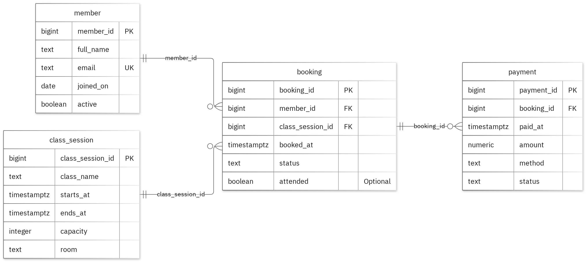

# MIT 8103 Advanced Database Systems

**FitPulse (Community Fitness Gym Management System)** · Favour Okoye · Student ID 301904993

**GitHub repository:** [fokoye4993-oss/Okoye_Favour_301904993](https://github.com/fokoye4993-oss/Okoye_Favour_301904993)

This document summarises the five portfolio activities completed for the FitPulse case study. The records and results are fictional examples prepared for the exercises. The repository contains the implementation files, detailed explanations and supporting evidence. Before submitting this document through the LMS, ensure the repository is accessible to the assessor.

## Case study

FitPulse is a community fitness gym management system for members, front-desk staff and administrators. Its relational database supports member registration, class scheduling, class bookings and payment records. The core PostgreSQL design uses four related tables: `member`, `class_session`, `booking` and `payment`. Their keys and constraints represent the relationships and business rules, including valid references and booking statuses.

The portfolio uses the relational design as its foundation, then explores query performance, transaction behaviour, an event-oriented NoSQL model and a proposed distributed deployment. The exercises use sample data; Portfolio 5 is a design discussion rather than a deployed cloud system.

## Portfolio 1: Database Design and Modelling

I organised the relational design into 4 tables. Primary keys identify records, foreign keys preserve the links, and checks enforce the stated business rules. A member may have at most one confirmed or waitlisted booking for a class session; enforce uniqueness on member_id and class_session_id only for those active statuses. The normalisation examples show the sample data at 1NF, 2NF and 3NF. All 11 deliberately invalid inserts were rejected without changing the valid sample rows.

Figure 1. Tables, keys and relationships. PK: primary key; FK: foreign key; UK: unique value.

<!-- PAGE BREAK -->

## Portfolio 2: Query Processing and Optimisation

I wrote SQL queries to join bookings with member and class information, filter bookings by timestamp, and count bookings by member. The sample join returned two records, illustrating how related information can be retrieved from the normalised tables.

I then compared a filtered lookup before and after creating an index, using a separate table with 25,000 performance rows. In three measured runs, the median execution time changed from 1.268 ms to 0.176 ms. The execution plan changed from a sequential scan to a bitmap index scan and bitmap heap scan, and the reported buffer hits decreased from 139 to 30. Both phases returned the same records. These measurements apply to this query and environment; an index also has storage and write-maintenance costs.

**Evidence:** [Query results](https://github.com/fokoye4993-oss/Okoye_Favour_301904993/blob/main/portfolio-2-query-optimisation/screenshots/Okoye_Favour_301904993_P2_QueryResults.png) · [Index comparison](https://github.com/fokoye4993-oss/Okoye_Favour_301904993/blob/main/portfolio-2-query-optimisation/screenshots/Okoye_Favour_301904993_P2_IndexComparison.png)

**Materials:** [Portfolio 2 files](https://github.com/fokoye4993-oss/Okoye_Favour_301904993/tree/main/portfolio-2-query-optimisation)

## Portfolio 3: Transactions and Concurrency

I used a temporary counter associated with a booking to demonstrate transaction behaviour without changing the case study's original business fields. The exercises covered `COMMIT`, `ROLLBACK` and PostgreSQL's `READ COMMITTED` isolation level. An uncommitted update remained hidden from the other session; a later rollback restored the previous committed value.

I also compared two concurrent increments. When both sessions read and update without locking, the final counter was 2 instead of the expected 3 because one increment was lost. With `SELECT FOR UPDATE`, the second session waited for the first, read the updated value and committed the expected final value of 3. This shows why a transaction may need to lock a row when concurrent changes depend on its current value.

**Evidence:** [Commit and rollback](https://github.com/fokoye4993-oss/Okoye_Favour_301904993/blob/main/portfolio-3-transactions-concurrency/screenshots/Okoye_Favour_301904993_P3_CommitRollback.png) · [Concurrency results](https://github.com/fokoye4993-oss/Okoye_Favour_301904993/blob/main/portfolio-3-transactions-concurrency/screenshots/Okoye_Favour_301904993_P3_ConcurrencyResult.png)

**Materials:** [Portfolio 3 files](https://github.com/fokoye4993-oss/Okoye_Favour_301904993/tree/main/portfolio-3-transactions-concurrency)

## Portfolio 4: NoSQL and Advanced Data Models

I modelled FitPulse booking activity as MongoDB documents in a `fitpulse_events` collection, using `booking_created` and `booking_cancelled` event types. The documents include shared event metadata, source-record keys, embedded snapshots of related booking and class details, references, and a flexible `details` field.

The script inserted four fictional events and ran queries by event type, source-record key and time range, as well as an aggregation counting documents by event type. Collection validation rejected an invalid date type, and the unique event identifier rejected a duplicate. The exercise illustrates the convenience of reading an event with its embedded context, balanced against duplicated snapshots that do not automatically change when relational records are updated. PostgreSQL remains the source of the relational rules in this design.

**Evidence:** [MongoDB documents and query results](https://github.com/fokoye4993-oss/Okoye_Favour_301904993/blob/main/portfolio-4-nosql/screenshots/Okoye_Favour_301904993_P4_DocumentsAndQueries.png)

**Materials:** [Portfolio 4 files](https://github.com/fokoye4993-oss/Okoye_Favour_301904993/tree/main/portfolio-4-nosql)

## Portfolio 5: Distributed and Cloud Database Exercise

I proposed a three-member MongoDB replica set distributed across three availability zones for the event collection, while keeping FitPulse's relational records in PostgreSQL. The design explains primary elections, majority acknowledgement, secondary replication lag and the limits of availability during network partitions. It also distinguishes replication, which supports availability, from backups, which are needed for recovery.

The proposal considers sharding only if the event collection grows enough to justify it. It discusses how a shard key must be chosen against real query and write patterns, and why a time-only increasing key may concentrate writes. Operational requirements include private networking, authentication, least-privilege access, TLS, monitoring and tested backups. No cloud service, replica set, failover, sharding or recovery test was deployed; this portfolio is a documented design exercise. The MongoDB proposal does not provide high availability for PostgreSQL, which would need its own plan.

**Evidence:** [Proposed architecture](https://github.com/fokoye4993-oss/Okoye_Favour_301904993/blob/main/portfolio-5-distributed-cloud/screenshots/Okoye_Favour_301904993_P5_ProposedDesign.png)

**Materials:** [Portfolio 5 files](https://github.com/fokoye4993-oss/Okoye_Favour_301904993/tree/main/portfolio-5-distributed-cloud)

## Individual reflection

I kept member, class_session, booking, payment in separate tables so their details could be maintained without repeating them in every related record. A member may have at most one confirmed or waitlisted booking for a class session; enforce uniqueness on member_id and class_session_id only for those active statuses. The constraint tests check this alongside the required values and record links. One issue illustrated by the two-session exercise is that both sessions can read the same value before either update is committed. Locking the row before reading preserves both increments. The index comparison also shows why I need to check the execution plan as well as the final answer: the same result can require different amounts of database work.

## AI-use declaration

I used GitHub Copilot and the portfolio generator to help prepare the database model, scripts and explanations. The generator ran the PostgreSQL and MongoDB exercises, checked their outputs and captured the result images. I remain responsible for checking and explaining the submitted work.

## References

- [PostgreSQL: constraints](https://www.postgresql.org/docs/17/ddl-constraints.html)
- [PostgreSQL: EXPLAIN](https://www.postgresql.org/docs/17/using-explain.html)
- [PostgreSQL: isolation](https://www.postgresql.org/docs/17/transaction-iso.html)
- [PostgreSQL: row locks](https://www.postgresql.org/docs/17/explicit-locking.html)
- [MongoDB: data modelling](https://www.mongodb.com/docs/manual/data-modeling/)
- [MongoDB: replication](https://www.mongodb.com/docs/manual/replication/)
- [MongoDB: sharding](https://www.mongodb.com/docs/manual/sharding/)
- [Mermaid: ER diagrams](https://mermaid.js.org/syntax/entityRelationshipDiagram.html)
